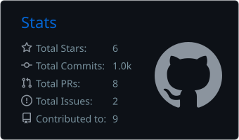
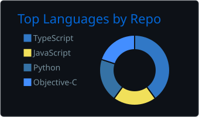

# Hi, I'm Carven 👋

**Independent Software Developer · AI Product Engineering**

I build AI tools for education, music, and automation — and ship them end-to-end, directing AI agents (Claude / Codex) through spec, build, verification, and release.

## 🚀 What I'm building

- <picture><source media="(prefers-color-scheme: dark)" srcset="assets/projects/lazy-ai-dark.svg" /></picture> **Lazy AI** prepares lesson plans, editable slides and science demonstrations from a teacher’s prompt. The app exports PPTX and DOCX. *Live site · private source.* [Lazy AI](https://lazy.bot.cd/)
- **Yozi AI** helps learners practice, revise and pick up where they left off, using a model they connect. *Version 2.2.0 · macOS Apple silicon download.* [Yozi AI](https://yozi.bot.cd/) · [Source](https://github.com/djblack1209-coder/Yozi-AI)
- **Latitude Browser** keeps browser profiles, proxy routes and local automation in one desktop workspace. *Fieldwork 2.2.0 · source available for noncommercial use.* [Latitude Browser](https://latitude.de5.net/) · [Source](https://github.com/djblack1209-coder/Latitude-Browser)
- **Cenlio** brings together intelligence briefs, research and multi-model collaboration. *In development · public reference repository.* [Cenlio](https://github.com/djblack1209-coder/Cenlio)
- **SonicExtract** is a DJ toolkit for music search, BPM and key analysis, stem separation and two-deck mixing. *Live site · private source.* [SonicExtract](https://sonicextract.online/)

## 🛠 Tech stack

         

## 📊 GitHub stats

## 🐍 Contribution snake

<picture>
  <source media="(prefers-color-scheme: dark)" srcset="https://raw.githubusercontent.com/djblack1209-coder/djblack1209-coder/output/github-contribution-grid-snake-dark.svg">
  <source media="(prefers-color-scheme: light)" srcset="https://raw.githubusercontent.com/djblack1209-coder/djblack1209-coder/output/github-contribution-grid-snake.svg">
  
</picture>

## 🌍 Work with me

Open to remote contract / project work worldwide — asynchronous and deliverable-based: AI product development, agent tooling, desktop apps.

Reach me on [Contra](https://contra.com/sheng_yan) or [X](https://x.com/BonoDJblack).
