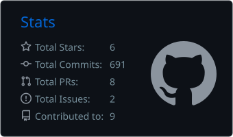
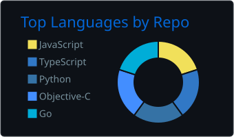

# Hi, I'm Carven 👋

**Independent Software Developer · AI Product Engineering**

I build AI tools for education, music, and automation — and ship them end-to-end, directing AI agents (Claude / Codex) through spec, build, verification, and release.

## 🚀 What I'm building

- **Lazy AI** — AI lesson-prep platform for teachers: lesson plans, editable courseware, and science animations from a single prompt
- **Yozi AI** — AI study coach: conversational learning with FSRS review scheduling · [Yozi-AI](https://github.com/djblack1209-coder/Yozi-AI)
- **SonicExtract** — audio toolkit for DJs: encrypted-format decryption, BPM/Key analysis, stem separation · [sonicextract.online](https://sonicextract.online)
- **Cenlio** — personal AI automation platform with a multi-model workbench · [Cenlio](https://github.com/djblack1209-coder/Cenlio)
- **Latitude Browser** — desktop workspace for browser profiles, proxy routing, and automation · [Latitude-Browser](https://github.com/djblack1209-coder/Latitude-Browser)

## 🛠 Tech stack

         

## 📊 GitHub stats

## 🐍 Contribution snake

<picture>
  <source media="(prefers-color-scheme: dark)" srcset="https://raw.githubusercontent.com/djblack1209-coder/djblack1209-coder/output/github-contribution-grid-snake-dark.svg">
  <source media="(prefers-color-scheme: light)" srcset="https://raw.githubusercontent.com/djblack1209-coder/djblack1209-coder/output/github-contribution-grid-snake.svg">
  
</picture>

## 🌍 Work with me

Open to remote contract / project work worldwide — asynchronous and deliverable-based: AI product development, agent tooling, desktop apps.
